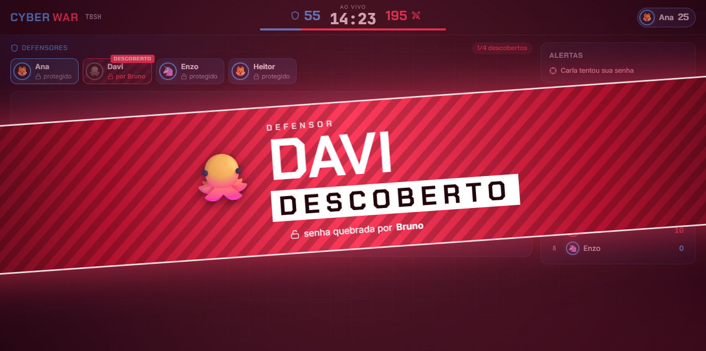

# CYBER WAR

Jogo multiplayer em tempo real sobre senhas, LGPD e segurança da informação para o curso Técnico em Manutenção e Suporte em Informática.

**Defensores** (azul) protegem senhas simples; **Invasores** (vermelho) tentam descobrir qual senha do banco pertence a cada defensor.

- Jogar: https://fernandobalbino.github.io/cyber-war/
- Professor: https://fernandobalbino.github.io/cyber-war/#prof



## Como funciona

1. O professor cria a sala e projeta o código.
2. Os alunos entram com nome e avatar. O professor sorteia as equipes e inicia.
3. Preparação de 2 minutos, depois 15 minutos de partida.
4. Cada invasor faz 1 tentativa por minuto: escolhe um defensor e uma senha do banco (100 palavras simples, 5 a 7 caracteres).
   Senha errada fica riscada **só para aquele defensor**, para toda a equipe.
5. Defensores recebem alerta com o nome do invasor e têm 4 segundos para bloquear; podem trocar 1 caractere da senha uma vez.
6. Acaba no tempo ou quando todos os defensores caem. O professor pode inverter as equipes e jogar outra rodada.

| Ação | Pontos |
|---|---|
| Invasor descobre uma senha | +100 |
| Tentativa que respeita todas as pistas da equipe | +10 |
| Defensor termina sem ser descoberto | +100 |
| Defensor bloqueia um ataque | +25 |
| Acerto no desafio de LGPD/segurança | +15 (a cada 2 acertos, defensor ganha +1 bloqueio) |

Ferramentas dos invasores: Expandir banco (+20 senhas e 1 letra, 1 vez por equipe), Comprimento, Composição e Rastrear (1 uso de cada por invasor).
Eventos do professor: Vazamento, Força bruta, Firewall e Desafio relâmpago.

## Arquitetura

- `src/` — site (Vite + React), publicado no GitHub Pages.
- `server/` — Node + Socket.IO no Render. Toda regra, senha e pontuação vive só no servidor; o navegador recebe apenas o banco público.
- `shared/` — tipos e o filtro de pistas usados pelos dois lados.

Senhas são fictícias, geradas para o jogo. Nenhuma senha real de aluno é pedida ou guardada.

## Rodar localmente

```bash
npm install
npm run server      # servidor em http://localhost:3001
npm run dev         # site em http://localhost:5173
npm test            # regras do jogo
```

Teste completo com robôs e prints (local, não usa o Render):

```bash
npm run build && npx vite preview --port 4173
PW_CHANNEL=msedge npm run e2e
```

Os prints ficam em `docs/prints/`.

Sala local com bots para jogar como aluno (o script faz o papel do professor):

```bash
npm run server
npm run dev -- --host
npm run bots -- 7
```
